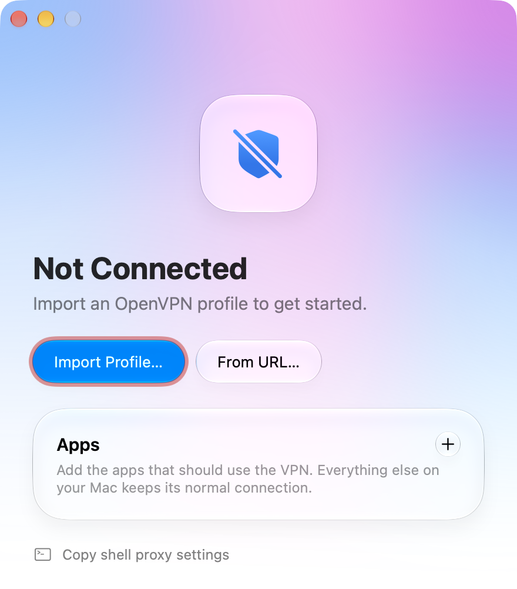

# AppVPN

A per-app OpenVPN client for macOS. It connects with a normal `.ovpn` profile, but only the apps you launch from AppVPN use the tunnel. Everything else on the Mac keeps its normal connection, routes and DNS.



> **Status:** the proxy, profile handling, reconnect logic and blocking are covered by tests, and CI runs an end-to-end test with a real tunnel on every push. See [Tests](#tests) and [Verifying a real connection](#verifying-a-real-connection).

## Requirements

- macOS 26 or later (the UI uses Liquid Glass)
- Xcode command-line tools (Swift 5.9+)
- OpenVPN 2.7+ from Homebrew: `brew install openvpn` (2.7 is needed for `--dns-updown disable`)

## Build and run

```bash
./build.sh
open build/AppVPN.app
```

`build.sh` compiles with SwiftPM and assembles an ad-hoc signed `build/AppVPN.app`. No Apple developer account or entitlements are needed.

## Using it

1. **Import a profile.** Click **Import Profile…**, drop an `.ovpn` file on the window, or use **From URL…** with a direct https link. Several profiles can be kept; the pill next to Connect switches, renames and deletes them.
2. **Connect.** macOS asks for an administrator password each time, because OpenVPN needs root to create the tunnel interface.
3. **Add apps** with **+** and start them with **Launch**. Only apps launched this way use the tunnel.
4. For terminal commands, click **Copy shell proxy settings** and paste the `export …` line into the shell.

If the VPN drops, OpenVPN reconnects by itself without another password prompt. While the tunnel is down, traffic from VPN apps is blocked; it never falls back to the normal connection.

### What "coverage" means

Per-app routing here works through a local proxy, so it depends on the app honouring proxy settings.

| Label in the app | Apps | What goes through the VPN |
|---|---|---|
| All traffic and DNS | Chromium browsers (Chrome, Edge, Brave…) | Everything, in a separate VPN-only browser profile |
| Web traffic only | Electron apps (VS Code, Postman, Slack…) | Chromium traffic; background Node traffic only if the app honours proxy variables |
| May bypass the VPN | Everything else | Only what the app sends through `HTTP(S)_PROXY` / `ALL_PROXY` |

Apps with their own SOCKS5 setting can be pointed at `127.0.0.1:18964` by hand.

## How it works

```
 selected app ──► 127.0.0.1:18964 (SOCKS5 / HTTP proxy in AppVPN)
                        │  every outbound socket is pinned to the
                        │  tunnel interface with IP_BOUND_IF
                        ▼
                     utunN ──► OpenVPN (root) ──► VPN server

 everything else ──► default route (unchanged)
```

- **Tunnel.** `vpn.sh start` runs OpenVPN as a root daemon with `--route-nopull --route-noexec --dns-updown disable`, so neither pushed nor profile-defined routes and DNS are applied. The `--up` hook adds one default route *scoped* to the tunnel interface; only sockets bound to that interface can use it.
- **Proxy.** `Sources/Proxy.swift` listens on loopback and speaks SOCKS5 and HTTP (`CONNECT` and plain). It resolves names itself over the tunnel, using the DNS server the VPN pushed, so lookups don't leak to the local resolver.
- **Fail closed.** The proxy is pinned only while OpenVPN reports `CONNECTED`. In any other state, or if AppVPN is not running, proxy connections fail.
- **Control.** `Sources/VPN.swift` talks to OpenVPN over its management socket (`~/.appvpn/mgmt.sock`): state changes, disconnect, and a forced reconnect after wake from sleep.
- **Launching.** Apps are started with proxy environment variables; Chromium and Electron apps also get `--proxy-server`, `--host-resolver-rules` (no local DNS) and a WebRTC policy that forbids UDP around the proxy.

### Files

| Path | Purpose |
|---|---|
| `Sources/App.swift` | Window, UI, app launching |
| `Sources/Profiles.swift` | Profile store, import validation, profile menu, its self-test |
| `Sources/VPN.swift` | OpenVPN lifecycle over the management socket |
| `Sources/Proxy.swift` | SOCKS5/HTTP proxy pinned to the tunnel, DNS over the tunnel, its self-test |
| `vpn.sh` | Root-side launcher: `check` (profile allowlist), `start`, `up` (scoped route) |
| `build.sh` | Builds and bundles the app |
| `make-icon.swift`, `AppIcon.icns` | Icon generator and its output |
| `test.sh`, `test-*.sh`, `test-killswitch.py` | Tests, see below |
| `.github/workflows/release.yml` | Test and publish a release on every push to `main` |

Runtime data lives in `~/.appvpn/`: `ovpn/` (imported profiles, mode 0600), `profiles/` (VPN-only browser profiles), `openvpn.log`, `mgmt.sock`. Preferences are in the `local.appvpn` defaults domain.

## Security model

- **Profiles are untrusted and OpenVPN runs as root**, so `vpn.sh check` is an allowlist: only ordinary client directives pass. Anything that runs code, loads a library, reads or writes other files, or is unknown is refused, with the directive named in the error. The same check runs at import and again at connect.
- Imports must be UTF-8, at most 1 MB, contain a `remote` line and not be an HTML page. Certificate and key files referenced by a profile are inlined only if they sit in the profile's own folder. URL imports must be https.
- Profiles needing a username and password (`auth-user-pass`) are not supported and are refused at import.
- The management socket is restricted to the user who started the connection.
- Known gap, marked `ponytail:` in `vpn.sh`: the root launcher runs from a user-writable app bundle and prompts for the password on every connect. The upgrade path is a root-owned LaunchDaemon.

## Limits

- Not a system-wide VPN and not a kernel-level per-app VPN. Apps that ignore proxy settings (Safari, most native apps, games) are not routed. Doing that properly needs a Network Extension, which requires the paid Apple Developer Program.
- IPv4 only through the tunnel; IPv6 targets are refused rather than sent direct.
- A network switch without sleep is noticed by OpenVPN's ping timeout (60 s by default, or whatever the server pushes), not instantly.
- No menu-bar item, launch at login, traffic statistics or auto-update.
- Source comments starting with `ponytail:` mark deliberate shortcuts and their upgrade path.

## Tests

```bash
./test.sh
```

`test.sh` builds the app and runs every check that must pass before a release. It quits and relaunches AppVPN and refuses to run while a tunnel is up.

| Script | What it proves | Needs |
|---|---|---|
| `test-launcher.sh` | The profile allowlist accepts ordinary client profiles and refuses anything that could run code or touch files as root; OpenVPN accepts the options `vpn.sh` adds | Nothing (`openvpn` for the option checks) |
| `test-profiles.sh` | Import, naming, rename, delete, URL rules, inlining of certificate files | Nothing |
| `AppVPN --selftest <interface>` | SOCKS5 and HTTP proxy paths, DNS over the pinned interface, failing closed with no tunnel | Internet |
| `test-killswitch.py` | Blocking before connect, while reconnecting, after OpenVPN stops and after AppVPN quits; Chrome does not fall back to a direct connection | Internet, optional Chrome |
| `test-e2e.sh` | A real tunnel: root launcher, scoped route, untouched system routes and DNS, proxy traffic entering the tunnel while direct traffic stays out, automatic reconnect, disconnect | Passwordless `sudo` |

`test-e2e.sh` starts a throwaway OpenVPN server and client on the same machine. Because OpenVPN needs root, it runs on CI and is skipped locally unless `sudo` works without a password.

## Releases

Every push of code to `main` runs `./test.sh` on GitHub Actions ([.github/workflows/release.yml](.github/workflows/release.yml)); if all checks pass, the build is published as release `v0.1.<run number>` with `AppVPN-<version>.dmg` attached (`./build.sh dmg` makes the same disk image locally). Pull requests run the same tests without publishing. Changes to documentation only do not trigger a release.

To install, open the disk image and drag AppVPN to Applications. The app is ad-hoc signed and not notarized, so a downloaded copy has to be released from quarantine once before the first launch:

```bash
xattr -dr com.apple.quarantine /Applications/AppVPN.app
```

## Verifying a real connection

1. Connect with a working profile.
2. Routing is untouched: `netstat -rn -f inet` still shows the normal default route, plus a `default` row on `utunN` with the `I` (scoped) flag.
3. The proxy exits through the VPN, the system does not:

   ```bash
   curl -s -x socks5h://127.0.0.1:18964 ifconfig.me   # VPN address
   curl -s ifconfig.me                                 # your own address
   ```

4. Sleep and wake the Mac: no password prompt, the first command fails while the app shows "Reconnecting…", then works again.

Troubleshooting starts with `~/.appvpn/openvpn.log`.
