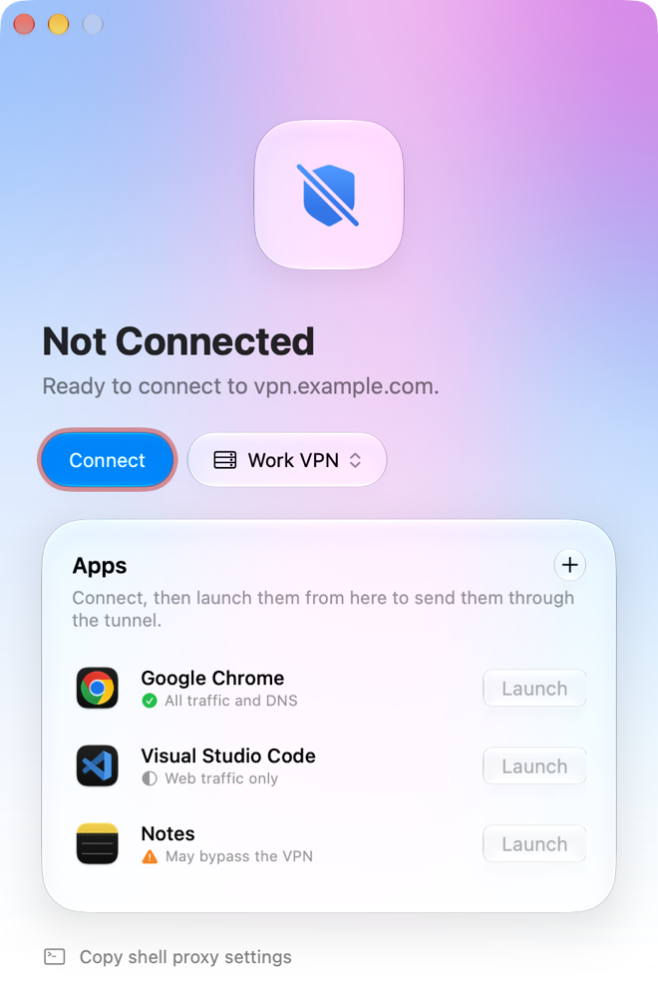
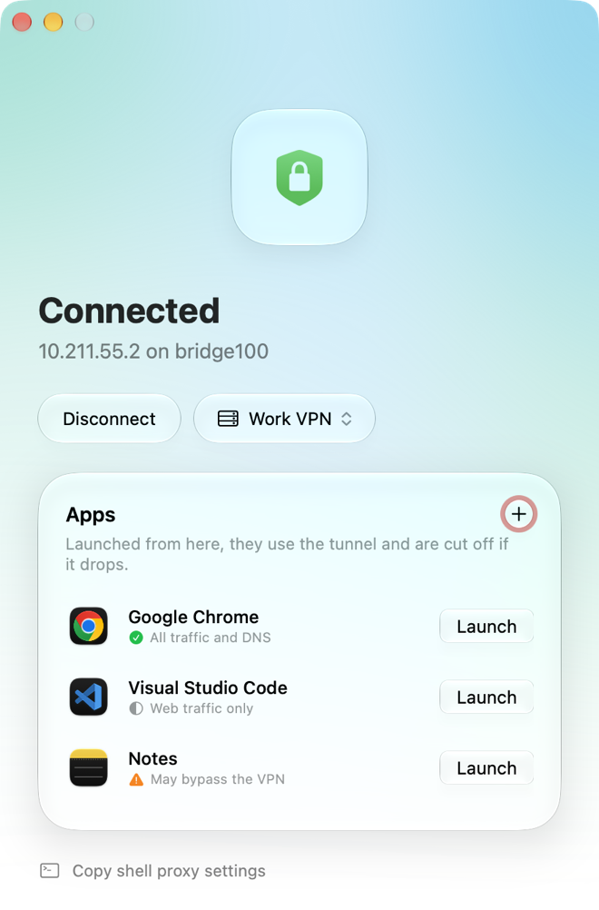
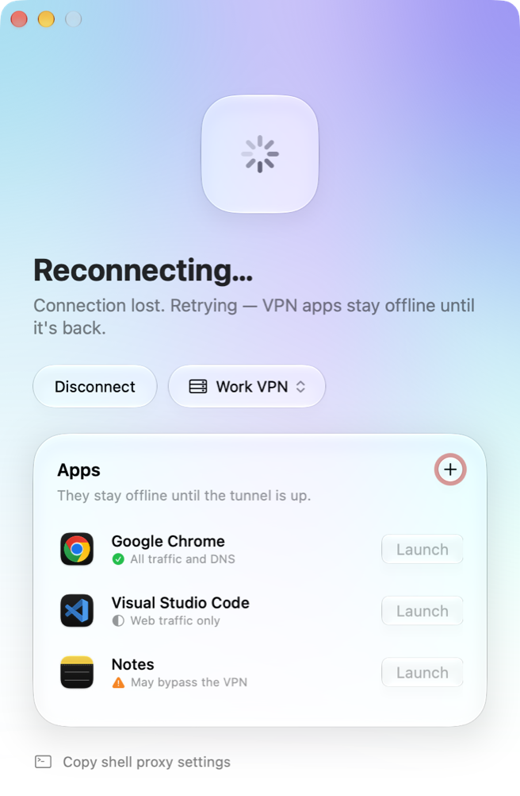
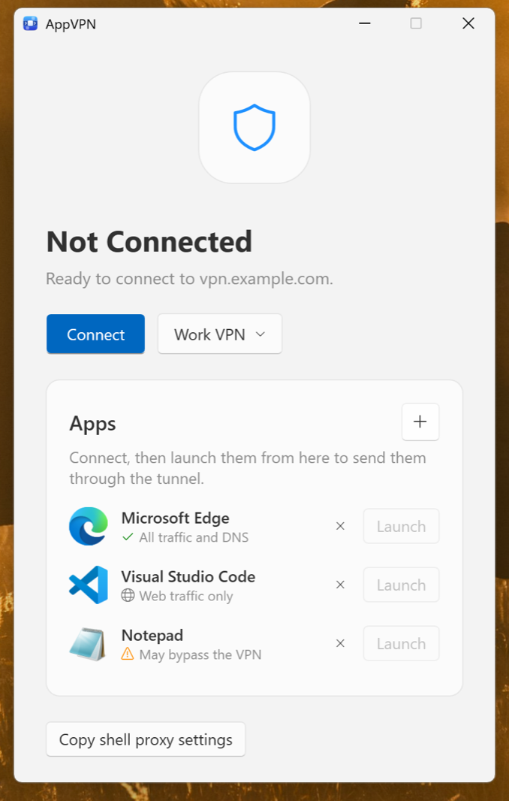
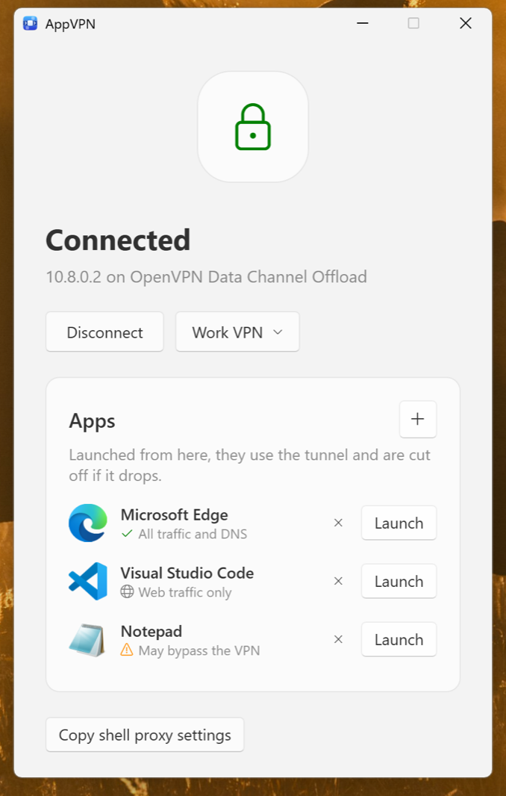
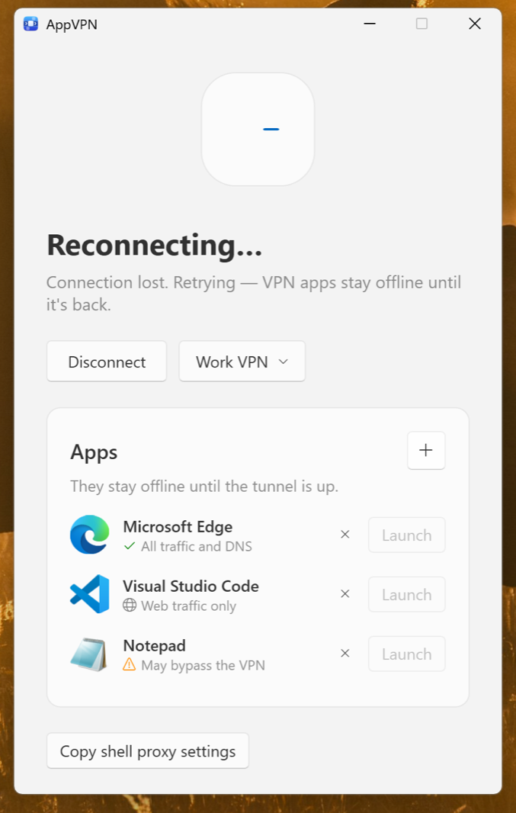

# AppVPN

A per-app OpenVPN client for macOS and Windows. It connects with a normal `.ovpn` profile, but only the apps you launch from AppVPN use the tunnel. Everything else on the computer keeps its normal connection, routes and DNS.

<table>
  <tr>
    <th></th>
    <th>Ready</th>
    <th>Connected</th>
    <th>Connection lost</th>
  </tr>
  <tr>
    <th>macOS</th>
    <td></td>
    <td></td>
    <td></td>
  </tr>
  <tr>
    <th>Windows</th>
    <td></td>
    <td></td>
    <td></td>
  </tr>
</table>

Both apps have the same window, the same local proxy and the same rule: an app launched from AppVPN is blocked while the tunnel is down, never sent over the normal connection.

> **Status:** the proxy, profile handling, reconnect logic and blocking are covered by tests, and CI runs an end-to-end test with a real tunnel on every push, on macOS and on Windows. See [Tests](#tests) and [Verifying a real connection](#verifying-a-real-connection).

## Install

Download the latest build from [Releases](https://github.com/ChaturnaK/AppVPN/releases).

| | macOS | Windows |
|---|---|---|
| Needs | macOS 26 or later on Apple silicon (the UI uses Liquid Glass) | Windows 11, x64 or ARM. Windows 10 on x64 should work but has not been tested |
| File | `AppVPN-<version>.dmg` | `AppVPN-<version>-x64-setup.exe` for most PCs, `AppVPN-<version>-arm64-setup.exe` for ARM PCs |
| OpenVPN | Inside the app | Installed by the setup program if the PC has none |

**macOS.** Open the disk image and drag AppVPN to Applications. The app is ad-hoc signed and not notarized, so a downloaded copy has to be released from quarantine once before the first launch:

```bash
xattr -dr com.apple.quarantine /Applications/AppVPN.app
```

**Windows.** Run the setup program for your PC: `x64` for a PC with an Intel or AMD processor, `arm64` for one with an ARM processor such as a Snapdragon (Settings > System > About, "System type", says which). The x64 one also works on an ARM PC, where Windows emulates the app. It is not code-signed, so SmartScreen asks first: choose **More info**, then **Run anyway**. It installs AppVPN and, if the PC has no OpenVPN 2.7 or later, OpenVPN Community with it. OpenVPN cannot live inside the app as it does on macOS: the tunnel needs OpenVPN's signed driver, which only OpenVPN's own installer sets up. An older OpenVPN is upgraded, a newer one is left alone, and removing AppVPN leaves OpenVPN installed. If OpenVPN's installer fails, setup stops and says so instead of installing an app that cannot connect.

## Using it

1. **Import a profile.** Click **Import Profile…**, drop an `.ovpn` file on the window, or use **From URL…** with a direct https link. Several profiles can be kept; the button next to Connect switches, renames and deletes them.
2. **Connect.** The system asks for administrator approval each time, because OpenVPN needs it to create the tunnel: a password prompt on macOS, a "Do you want to allow this app" prompt naming OpenVPN on Windows.
3. **Add apps** with **+** and start them with **Launch**. Only apps launched this way use the tunnel. On Windows, apps are programs (`.exe`); the dialog opens in the Start menu and accepts shortcuts.
4. For terminal commands, click **Copy shell proxy settings** and paste the line into the shell (`export …` on macOS, `$env:…` for PowerShell on Windows).

If the VPN drops, OpenVPN reconnects by itself without another prompt. While the tunnel is down, traffic from VPN apps is blocked; it never falls back to the normal connection.

### What "coverage" means

Per-app routing here works through a local proxy, so it depends on the app honouring proxy settings.

| Label in the app | Apps | What goes through the VPN |
|---|---|---|
| All traffic and DNS | Chromium browsers (Chrome, Edge, Brave…) | Everything, in VPN-only browser profiles kept apart from your normal ones. Once the browser has been launched, **Launch** lists its profiles and **New Profile** adds one. It also lists the browser's everyday profiles (Chrome, Edge, Brave, Vivaldi, Chromium), logins and all: opening one restarts the normal browser, and all of its windows use the VPN until it is quit |
| Web traffic only | Electron apps (VS Code, Postman, Slack…) | Chromium traffic; background Node traffic only if the app honours proxy variables |
| May bypass the VPN | Everything else | Only what the app sends through `HTTP(S)_PROXY` / `ALL_PROXY` |

Apps with their own SOCKS5 setting can be pointed at `127.0.0.1:18964` by hand.

## How it works

```
 selected app ──► 127.0.0.1:18964 (SOCKS5 / HTTP proxy in AppVPN)
                        │  every outbound socket is pinned
                        │  to the tunnel interface
                        ▼
                  tunnel interface ──► OpenVPN (administrator) ──► VPN server

 everything else ──► default route (unchanged)
```

- **Tunnel.** OpenVPN runs as administrator and is told to apply none of the routes or DNS settings the server pushes. The tunnel gets one default route that only sockets pinned to the tunnel can use.
- **Proxy.** AppVPN listens on loopback and speaks SOCKS5 and HTTP (`CONNECT` and plain). It resolves names itself over the tunnel, using the DNS server the VPN pushed, so lookups don't leak to the local resolver.
- **Fail closed.** The proxy is pinned only while OpenVPN reports `CONNECTED`. In any other state, or if AppVPN is not running, proxy connections fail.
- **Control.** AppVPN talks to OpenVPN over its management interface: state changes, disconnect, and a forced reconnect after wake from sleep.
- **Launching.** Apps are started with proxy environment variables; Chromium and Electron apps also get `--proxy-server`, `--host-resolver-rules` (no local DNS) and a WebRTC policy that forbids UDP around the proxy.

The two systems offer different tools for this, so the same design is built differently:

| | macOS | Windows |
|---|---|---|
| Code | Swift and SwiftUI in `Sources/`, root-side shell launcher `vpn.sh` | C# and WPF in `windows/`, no packages beyond .NET |
| Pinning the proxy's sockets | `IP_BOUND_IF` | `IP_UNICAST_IF` |
| The tunnel's route | A default route *scoped* to the tunnel interface (`utunN`), added by OpenVPN's `--up` hook | A default route on the tunnel adapter with metric 9000, which loses to every real route |
| Pushed routes and DNS | `--route-nopull --route-noexec --dns-updown disable` | `--route-nopull`, and `--pull-filter ignore` for `ip-win32` and `route-method` |
| Routes and DNS written in the profile | Never applied | Removed from the profile when it is imported |
| Checking the profile and starting OpenVPN | `vpn.sh check`, `vpn.sh start` | `Allowlist.cs`, `Vpn.Start` |
| OpenVPN | Bundled in the app | The installed OpenVPN Community |
| Management interface | Unix socket `~/.appvpn/mgmt.sock`, restricted to the user | `127.0.0.1:18965` with a new random password per connection |
| Runtime data | `~/.appvpn/`: `ovpn/` (imported profiles, mode 0600), `profiles/` (VPN-only browser profiles), `openvpn.log` | `%LOCALAPPDATA%\AppVPN\`: the same folders and log, plus `settings.json` |
| Preferences | `local.appvpn` defaults domain | `settings.json` |

## Security model

On both systems:

- **Profiles are untrusted and OpenVPN runs as administrator**, so the profile check is an allowlist: only ordinary client directives pass. Anything that runs code, loads a library, reads or writes other files, or is unknown is refused, with the directive named in the error. The validator reads a profile exactly the way OpenVPN does, and it achieves that by refusing input where the two could disagree: quoted or backslash-escaped arguments, control characters, lines of 250 characters or more, and malformed or unterminated certificate blocks. The same check runs at import and again at connect. Both implementations (`vpn.sh` and `Allowlist.cs`) are tested with one list of cases, `test-cases.sh`.
- Imports must be UTF-8, at most 1 MB, contain a `remote` line and not be an HTML page. Certificate and key files referenced by a profile are inlined only if they sit in the profile's own folder. URL imports must be https.
- Profiles needing a username and password (`auth-user-pass`) are not supported and are refused at import.

macOS:

- The management socket is restricted to the user who started the connection.
- Known gap, marked `ponytail:` in `vpn.sh`: the root launcher and the bundled OpenVPN run from a user-writable app bundle, and the password is asked for on every connect. The upgrade path is a root-owned LaunchDaemon.

Windows:

- **A stricter allowlist.** Some settings do nothing on macOS but act on Windows. `win-sys`, `ip-win32` and `route-method` are refused: they choose the programs OpenVPN runs as administrator and how it sets up the adapter. `route`, `route-ipv6`, `redirect-gateway`, `redirect-private`, `dhcp-option`, `dns`, `block-outside-dns`, `block-ipv6` and `register-dns` are removed from the profile at import and refused at connect, because OpenVPN on Windows has no switch to ignore them when they are written in the profile (`block-outside-dns` would block DNS for the whole PC). One parser does both, and the stored profile must pass the strict check, so a slip refuses the profile instead of letting a line through.
- **The management port is not trusted.** Any program on the PC could listen on a TCP port and report "connected". AppVPN talks to the port only while every listener on it is the installed `openvpn.exe`, and it pins the proxy only to an OpenVPN tunnel adapter, whatever the port reports.
- AppVPN and OpenVPN are both installed where only administrators can write. Known gap, marked `ponytail:` in `Vpn.cs`: OpenVPN's arguments and the profile come from the unelevated app, and approval is asked for on every connect. The upgrade path is a Windows service that owns the check and the start.

## Limits

On both systems:

- Not a system-wide VPN and not a kernel-level per-app VPN. Apps that ignore proxy settings (Safari, most native apps, games) are not routed. Doing that properly needs a Network Extension on macOS, which requires the paid Apple Developer Program, or a filter driver on Windows.
- IPv4 only through the tunnel; IPv6 targets are refused rather than sent direct.
- A network switch without sleep is noticed by OpenVPN's ping timeout (60 s by default, or whatever the server pushes), not instantly.
- No menu-bar or tray item, launch at login, traffic statistics or auto-update.
- Neither app is signed with a paid certificate (see [Install](#install)).
- Source comments starting with `ponytail:` mark deliberate shortcuts and their upgrade path.

macOS:

- Each build carries whatever OpenVPN version Homebrew had at build time, so OpenVPN security updates reach users only through a new AppVPN build.

Windows:

- Windows has no routes scoped to one adapter. If every real network connection goes away while the tunnel adapter is still up, Windows sends other programs' traffic to the tunnel's route. The tunnel has lost its own connection to the server at that point, so the traffic goes nowhere, but this is weaker than the scoped route on macOS.
- PCs with Smart App Control turned on refuse the unsigned setup program.
- Apps from the Microsoft Store cannot be started with proxy settings; only ordinary programs can be added.
- If OpenVPN is killed instead of stopped, its route stays on the disconnected tunnel adapter until the PC restarts. It is replaced on the next connect to the same VPN.
- OpenVPN security updates come from a new AppVPN setup program or from OpenVPN's own installer.

## Building from source

**macOS** needs the Xcode command-line tools (Swift 5.9+) and OpenVPN 2.7+ from Homebrew (`brew install openvpn`), which the build copies into the app.

```bash
./build.sh               # build/AppVPN.app
./build.sh dmg           # also build/AppVPN-<version>.dmg
open build/AppVPN.app
```

`build.sh` compiles with SwiftPM and assembles an ad-hoc signed `build/AppVPN.app`. No Apple developer account or entitlements are needed. It copies Homebrew's `openvpn` and the libraries it needs into the app (`Contents/Helpers`, `Contents/Frameworks`) and relinks them to load from there, so the finished app runs on a Mac without Homebrew. Their licence texts go into `Contents/Resources/licenses`.

**Windows** needs the .NET 10 SDK, and Inno Setup for the setup program.

```powershell
windows\build.ps1            # out\app\AppVPN.exe
windows\build.ps1 installer  # also out\AppVPN-<version>-<x64 or arm64>-setup.exe
windows\build.ps1 openvpn    # installs the OpenVPN the setup program carries (elevated), for the tests
```

`build.ps1` builds for the kind of PC it runs on, x64 or ARM, so each setup program is built on its own kind. The setup program carries OpenVPN's own installer (the x64 one carries the ARM installer too, because it also runs on ARM PCs), downloaded from OpenVPN's server and checked against SHA-256 values in `build.ps1`. The Windows project also compiles on a Mac (`dotnet build windows`), which cannot run it.

OpenVPN itself is GPL-2.0; its source is at <https://github.com/OpenVPN/openvpn>.

### Files

| Path | Purpose |
|---|---|
| `Sources/App.swift` | macOS: window, UI, app launching |
| `Sources/Profiles.swift` | macOS: profile store, import validation, profile menu, its self-test |
| `Sources/VPN.swift` | macOS: OpenVPN lifecycle over the management socket |
| `Sources/Proxy.swift` | macOS: SOCKS5/HTTP proxy pinned to the tunnel, DNS over the tunnel, its self-test |
| `vpn.sh` | macOS: root-side launcher: `check` (profile allowlist), `start`, `up` (scoped route) |
| `build.sh` | macOS: builds the app, bundles OpenVPN into it, optionally packages a disk image |
| `make-icon.swift`, `AppIcon.icns` | Icon generator and its output |
| `test.sh`, `test-*.sh`, `test-killswitch.py` | macOS tests, see below |
| `windows/MainWindow.xaml`, `.xaml.cs` | Windows: window, UI, app launching |
| `windows/Profiles.cs` | Windows: profile store, import validation, its self-test |
| `windows/Allowlist.cs` | Windows: the profile allowlist (`vpn.sh check` in C#) |
| `windows/Vpn.cs` | Windows: starting OpenVPN as administrator, OpenVPN lifecycle over the management port |
| `windows/Proxy.cs` | Windows: SOCKS5/HTTP proxy pinned to the tunnel, DNS over the tunnel, its self-test |
| `windows/check/` | Runs `Allowlist.cs` against `test-cases.sh`; plain .NET, so it also runs on a Mac |
| `windows/build.ps1`, `installer.iss` | Windows: builds the app and the setup program |
| `windows/test.ps1`, `test-*.ps1` | Windows tests, see below |
| `test-cases.sh` | The profiles the allowlist must accept and refuse, shared by both checks |
| `.github/workflows/release.yml` | Test on macOS and Windows and publish a release on every push to `main` |

## Tests

Each system has one script that builds the app and runs every check that must pass before a release. It quits and relaunches AppVPN and refuses to run while a tunnel is up.

```bash
./test.sh            # macOS
```

```powershell
windows\test.ps1     # Windows
```

| What is proved | macOS | Windows |
|---|---|---|
| The profile allowlist accepts ordinary client profiles and refuses anything that could run code or touch files as administrator | `test-launcher.sh`, which also checks that OpenVPN accepts the options `vpn.sh` adds | `windows/check`, with the Windows-only rules; needs `sh` (Git for Windows), also runs on a Mac |
| Import, naming, rename, delete, URL rules, inlining of certificate files | `test-profiles.sh` | `AppVPN --selftest-profiles`, with removal of routing and DNS lines |
| SOCKS5 and HTTP proxy paths, DNS over the pinned interface, failing closed with no tunnel | `AppVPN --selftest <interface>` | `AppVPN --selftest <interface index>` |
| Blocking whenever there is no tunnel; a browser does not fall back to a direct connection | `test-killswitch.py` plays OpenVPN's management interface: before connect, while reconnecting, after OpenVPN stops, after AppVPN quits; Chrome | `test-killswitch.ps1`: before connect and after AppVPN quits; a stranger on the management port is ignored; Edge (unelevated session only) |
| A real tunnel: start as administrator, the tunnel's route, untouched system routes and DNS, proxy traffic entering the tunnel while direct traffic stays out, blocking when the server dies, automatic reconnect, disconnect | `test-e2e.sh`, needs passwordless `sudo` | `test-e2e.ps1`, needs an elevated PowerShell and OpenVPN; its server also pushes both DNS forms, `block-outside-dns`, `ip-win32` and `route-method` |

The end-to-end tests start a throwaway OpenVPN server and client on the same machine. Because OpenVPN needs administrator rights, they run on CI and are skipped locally unless those rights are there without a prompt. The proxy and kill-switch checks need internet.

## Verifying a real connection

1. Connect with a working profile.
2. Routing is untouched.
   - macOS: `netstat -rn -f inet` still shows the normal default route, plus a `default` row on `utunN` with the `I` (scoped) flag.
   - Windows: `route print -4` still shows the normal default route, plus one on the tunnel adapter with a metric of 9000 or more.
3. The proxy exits through the VPN, the system does not (`curl.exe` on Windows):

   ```bash
   curl -s -x socks5h://127.0.0.1:18964 ifconfig.me   # VPN address
   curl -s ifconfig.me                                 # your own address
   ```

4. Sleep and wake the computer: no approval prompt, the first command fails while the app shows "Reconnecting…", then works again.

Troubleshooting starts with the OpenVPN log: `~/.appvpn/openvpn.log` on macOS, `%LOCALAPPDATA%\AppVPN\openvpn.log` on Windows.

## Releases

Every push of code to `main` runs `./test.sh` on macOS and `windows\test.ps1` on Windows, once on x64 and once on ARM, on GitHub Actions ([.github/workflows/release.yml](.github/workflows/release.yml)); if all checks pass on all three, the build is published as release `v0.1.<run number>` with `AppVPN-<version>.dmg` and the two Windows setup programs attached. Pull requests run the same tests without publishing. Changes to documentation only do not trigger a release.

## AI usage disclosure

AppVPN was built with [Claude Code](https://claude.com/claude-code), Anthropic's AI coding assistant. It was used to write and modify much of the source, the tests and this documentation. The maintainer directs the work and reviews the changes, and the behaviour is checked by the test suite above rather than by trust in the tooling. Because the app starts OpenVPN as administrator, read `vpn.sh` and `Sources/` (on Windows, `windows/`) yourself before trusting it with a profile that matters.
